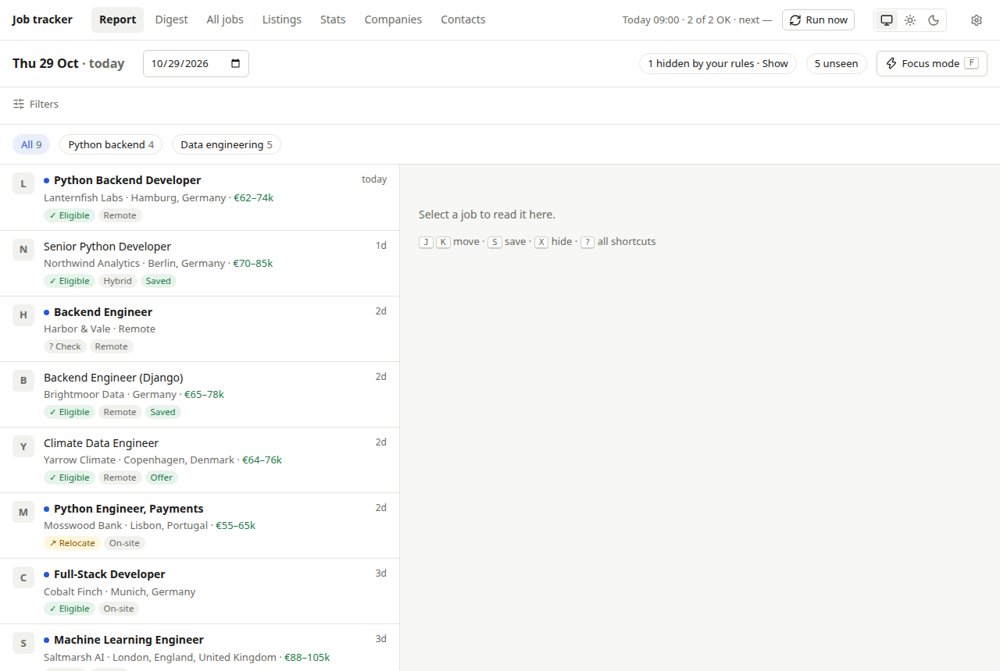
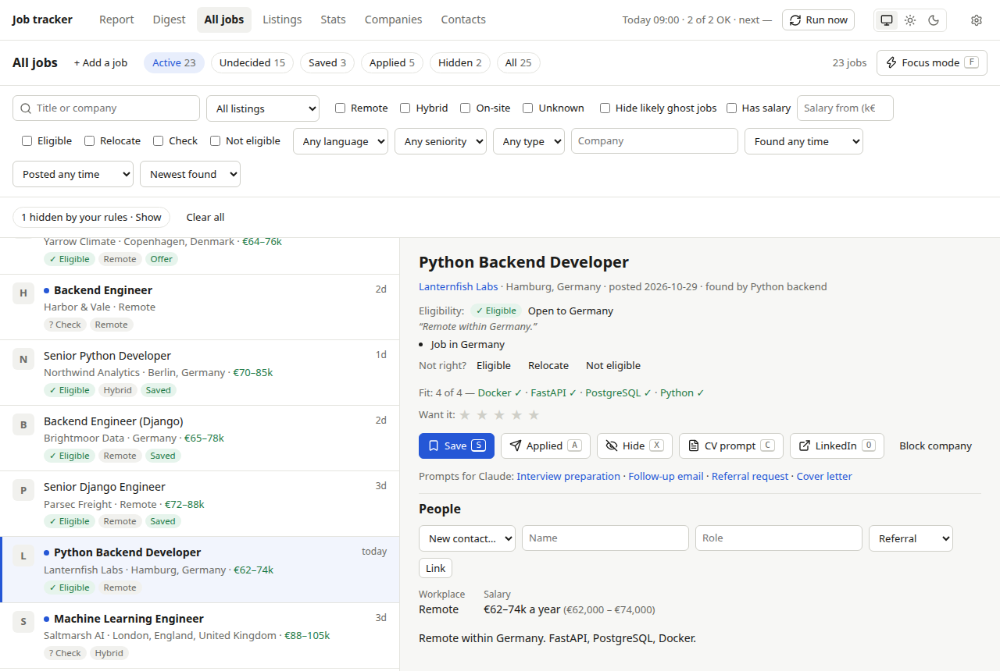
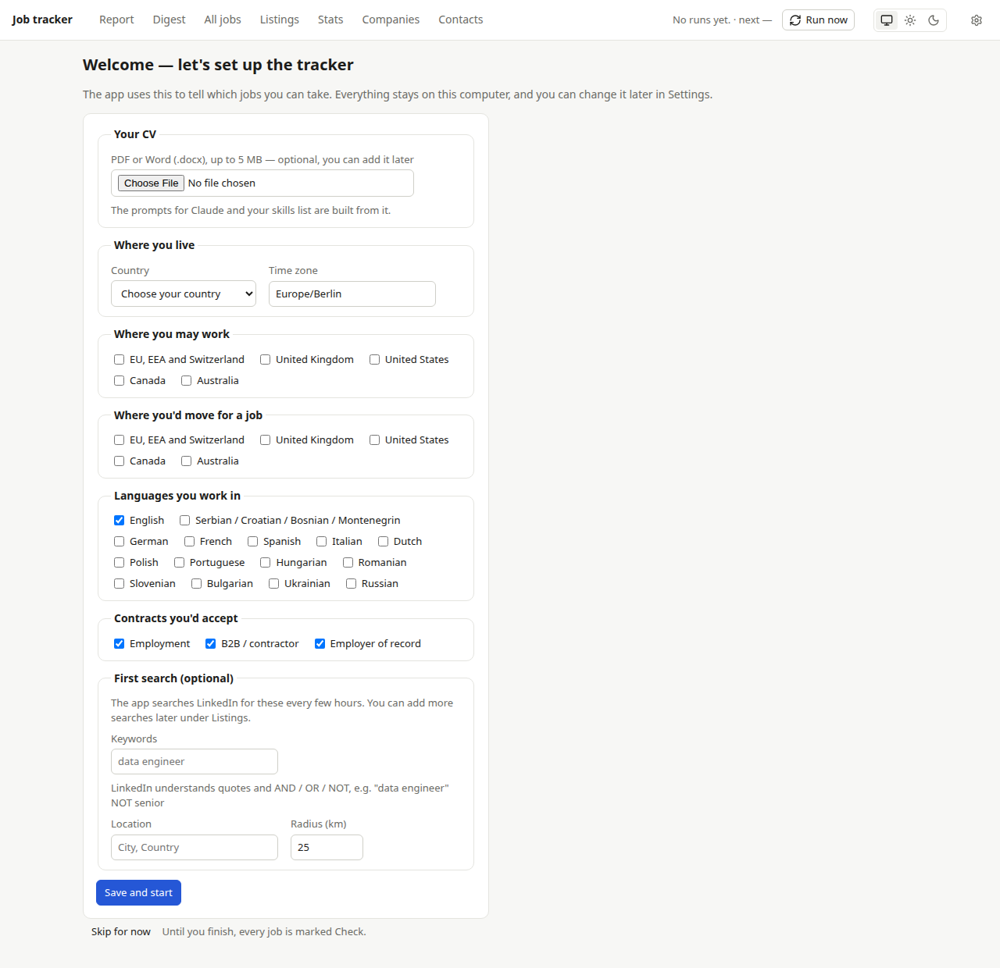
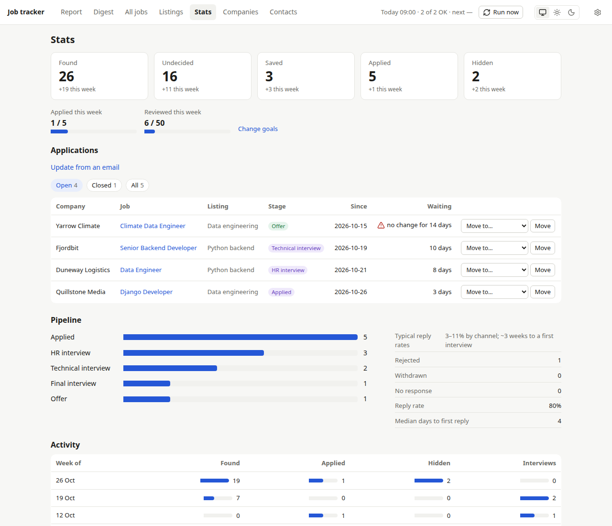

# Job tracker

A job search assistant that runs on your own computer. Every few hours it searches LinkedIn (and a few remote-job
sites) for the jobs you describe, shows each job once, and tells you which ones you can actually take: where you're
allowed to work, the languages you speak and the contracts you accept. You save, hide and apply from one place, and
it keeps track of your applications.

Nothing is uploaded anywhere: your jobs, your CV and your notes stay on your computer.



## What you get

- **A daily report** of the new jobs, each marked Eligible, Relocate, Check or Not eligible, with the sentence that
  decided it.
- **All jobs** with filters (remote, salary, eligibility, language and more), a reading pane and keyboard shortcuts.
- **Applications**: mark a job Applied, record each step (HR interview, technical interview, offer…), get reminded to
  follow up, and see your progress in Stats.
- **Ready-made prompts for Claude** to tailor your CV, write a cover letter or a follow-up email, ask for a referral or
  prepare for an interview.
- **Translations** of non-English jobs (with a free DeepL key), salaries shown as yearly euros, warning signs for
  ghost jobs and scams, and a short daily digest you can get on your phone.



## Install

You install it once; after that it starts by itself whenever your computer and Docker Desktop are running. It takes
about 15 minutes, most of it waiting for downloads.

### 1. Install Docker Desktop

The tracker runs inside Docker Desktop, a free app that runs small self-contained programs.

- **Windows:** download Docker Desktop from https://www.docker.com/products/docker-desktop/ and run the installer.
  Restart the computer if it asks you to.
- **Mac:** download Docker Desktop from the same page. Pick **Apple chip** or **Intel chip** (Apple menu →
  **About This Mac** shows which you have), open the downloaded file and drag Docker into **Applications**.
- **Linux:** install Docker Desktop for Linux (https://docs.docker.com/desktop/setup/install/linux/) or Docker Engine
  with the Compose plugin.

Open Docker Desktop and wait until it says the engine is running. In Docker Desktop's settings, turn on **Start Docker
Desktop when you sign in**, so the tracker keeps running after a restart.

### 2. Make a folder and open a terminal in it

Make a new folder, for example **Job tracker** in your Documents. Then open a terminal in that folder:

- **Windows:** open the folder in File Explorer, click the address bar, type `cmd` and press Enter.
- **Mac:** in Finder, right-click the folder and choose **New Terminal at Folder**. (If you don't see it: open
  **Terminal**, type `cd ` with a space after it, drag the folder into the window and press Return.)
- **Linux:** right-click inside the folder and choose **Open in Terminal**.

### 3. Download the tracker's file

Copy this line into the terminal and press Enter:

```bash
curl -L -o docker-compose.yml https://raw.githubusercontent.com/Brav/JobHunting/main/install/docker-compose.yml
```

On Linux without `curl`, use this instead:

```bash
wget -O docker-compose.yml https://raw.githubusercontent.com/Brav/JobHunting/main/install/docker-compose.yml
```

This saves `docker-compose.yml` (the file `install/docker-compose.yml` in this project) into your folder. It tells
Docker which program to run and where to keep its data.

### 4. Start the tracker

In the same terminal, type this and press Enter:

```bash
docker compose up -d
```

The first time, Docker downloads the tracker (a few minutes). When it finishes, the terminal shows that the job
tracker started. You can close the terminal.

### 5. Open it

Open http://localhost:8765 in your browser. Bookmark it: that's where the tracker lives from now on.

## First start: the setup page



The first time you open the tracker it shows a setup page. Fill it in once; you can change everything later in
**Settings** (the gear icon, top right).

- **Your CV** (optional): a PDF or Word file. The tracker keeps a copy and never changes it. The prompts for Claude
  and your skills list are made from it.
- **Where you live:** your country, and your time zone (filled in from your computer; correct it if it's wrong).
- **Where you may work:** the places where you're allowed to work, for example the EU if you're an EU citizen.
- **Where you'd move for a job:** places you'd relocate to.
- **Languages you work in** and **contracts you'd accept** (employment, contractor, employer of record).
- **First search** (optional): what to search for and where, for example `data engineer` in `Berlin, Germany`. The
  first search starts as soon as you press **Save and start**.

**Skip for now** opens the tracker straight away. Until you finish setup, every job is marked Check, and a reminder
at the top of each page links back to the setup page.

## Everyday use

- **Report** shows the jobs found today. Click a job to read it on the right. **Save** keeps it for later, **Hide**
  removes it and asks why; Stats sums up the reasons.
- **All jobs** has every job, with filters. Press **?** for keyboard shortcuts, or **Focus mode** to go through new
  jobs one at a time.
- **Listings** are your searches. Add one per kind of job and place; each runs every few hours. LinkedIn understands
  quotes and AND / OR / NOT, for example `"data engineer" NOT senior`.
- **Applying:** press **Applied** on a job, then record each step as it happens. **Stats** lists your applications,
  how long each has waited, and when to follow up. Got an email from an employer? Paste it into **Stats → Update from
  an email** and the tracker suggests the next step.
- **Prompts for Claude:** on a job, **CV prompt** (and the links next to it: interview preparation, follow-up email,
  referral request, cover letter) opens a ready-made prompt with the job and your CV. Copy it and paste it into
  Claude.ai.
- **Jobs from other sites:** on **All jobs**, **+ Add a job** gives you a bookmark button. Drag it to your browser's
  bookmarks bar; on any job page, click it and the job is added for you to check and save.
- **More job sites:** Settings → Preferences turns on Remote OK, Himalayas and Hacker News "Who is hiring".
  **Companies** lets you watch a company's own job board (Greenhouse, Lever or Ashby).
- **On your phone:** Settings → Preferences takes an [ntfy](https://ntfy.sh) address; the tracker then sends a short
  daily digest to the ntfy app.
- **Translation:** Settings → Translation takes a free DeepL key (https://www.deepl.com/pro-api). Non-English job
  titles are then translated, and descriptions when you open them.
- **Goals and breaks:** Settings → Preferences sets weekly goals, and a date to pause the searches until (for a
  holiday).



## Update to a new version

Open a terminal in your **Job tracker** folder (as in step 2 above) and run these two commands:

```bash
docker compose pull
docker compose up -d
```

Your jobs and settings are kept. (Docker Desktop's restart button restarts the version you already have; it doesn't
update.)

## Back up, or move to another computer

The tracker backs itself up every night and keeps the last 14 copies. To keep a copy of your own, open **Settings →
Backups and export** and download the zip. It holds `jobhunt.db` (your jobs, applications, searches and settings) and
two CSV files that open in any spreadsheet. Your CV and your DeepL key are not in the zip: add them again in Settings
after a move.

To move to another computer:

1. On the old computer, download the zip and unzip it.
2. On the new computer, install the tracker (steps 1 to 4 above) and press **Skip for now** on the setup page.
3. Copy `jobhunt.db` from the unzipped folder into the new **Job tracker** folder. Open a terminal in that folder (as
   in step 2) and run these four commands, one after the other:

   ```bash
   docker compose cp jobhunt.db jobhunt:/app/data/import.db
   docker compose stop
   docker compose run --rm jobhunt /app/.venv/bin/python -m jobhunt.backup restore /app/data/import.db
   docker compose start
   ```

4. Open http://localhost:8765. Your jobs are back; add your CV and DeepL key again in Settings.

## Stop it or remove it

- To pause it, stop the job tracker in Docker Desktop's **Containers** list; start it there again later.
- To remove it but keep your data, run `docker compose down` in its folder.
- `docker compose down -v` removes it **and deletes all your jobs and settings**. Download a backup first.

## Troubleshooting

- **"Cannot connect to the Docker daemon", or `docker` isn't found:** Docker Desktop isn't running. Open it, wait
  until the engine is running, and try again.
- **"no configuration file provided":** the terminal isn't in the folder with `docker-compose.yml`, or the download
  didn't work. Open the terminal in your **Job tracker** folder (step 2) and run the download command again (step 3).
- **The page doesn't open right after starting:** wait a minute and reload; the first start takes a moment.
- **"Port 8765 is already allocated":** something else uses that port. Open `docker-compose.yml` in a text editor,
  change `127.0.0.1:8765:8000` to `127.0.0.1:8766:8000`, run `docker compose up -d` again, and open
  http://localhost:8766 instead.
- **"Rate limited by LinkedIn" on the Report:** LinkedIn asked the tracker to slow down. It tries again on its own;
  wait a few hours rather than pressing **Run now** again and again.
- **You skipped setup by mistake:** open http://localhost:8765/setup.
- **Translations don't appear:** check the key in Settings → Translation. The free plan allows 500,000 characters a
  month; translations resume the next month.

## For developers

Running from the source, the tests, the environment variables, Claude Desktop (MCP) and releases are in
[docs/development.md](docs/development.md).

## Licence and LinkedIn

The code is under the MIT licence (`LICENSE`).

Searches read LinkedIn's public job search through [python-jobspy](https://github.com/speedyapply/JobSpy).
LinkedIn's terms don't allow automated access, so run it for yourself only, at your own risk, and keep the searches
modest (the default is every 4 hours). The app runs on your computer and sends your data nowhere unless you set up
translation (DeepL) or the phone push (ntfy).
